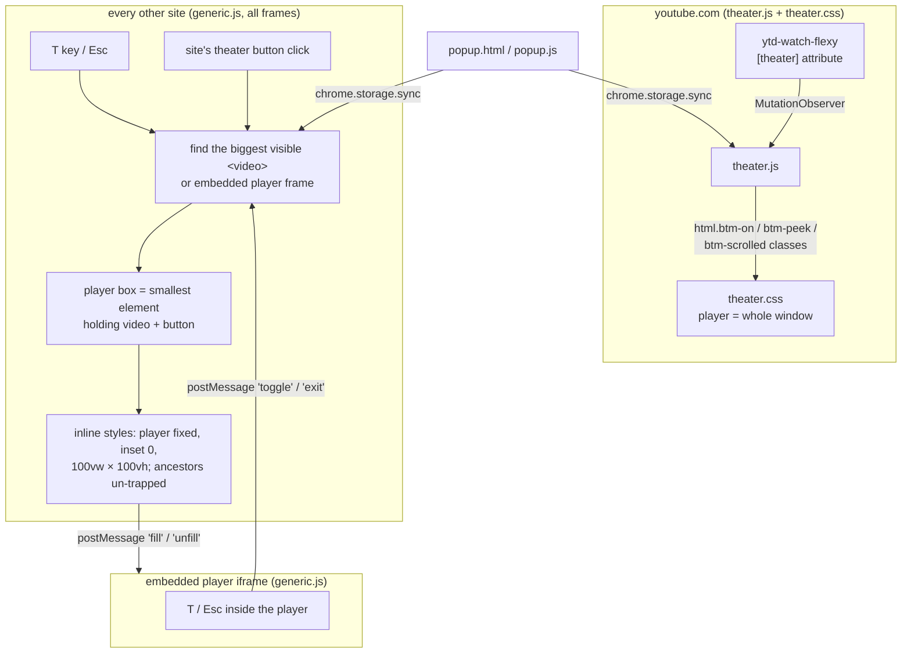

# Better Theater Mode

[](https://github.com/baverrr/Better-Theater-Mode-Chromium-Extension/actions/workflows/ci.yml)
[](https://github.com/baverrr/Better-Theater-Mode-Chromium-Extension/actions/workflows/codeql.yml)


[](LICENSE)

A Chromium extension (Chrome, Brave, Edge) that makes theater mode fill the whole browser window, edge
to edge on a black background, with the site's header and sidebars out of the way.

> [!TIP]
> **Press T on any page with a video.** The player fills the window; press **T** again or **Esc** and
> the page goes back exactly as it was. On YouTube, just use YouTube's own theater mode (**T** or the
> theater button).

| A video page as the site lays it out | After pressing **T** |
| --- | --- |
|  |  |

*The extension running in Brave on a local demo page (the "DemoTube" site and its video are made up for
the screenshot).*

**Why:** most sites' theater mode only widens the player a little; the header, the padding and often a
sidebar stay on screen. Full screen fixes that but takes over the whole display and hides your other
windows and tabs. This sits in between: the video fills the browser window and nothing else changes.

> [!IMPORTANT]
> An independent project, not made or endorsed by Google, YouTube or any other site it works on. It
> adjusts each site's page layout, so a site redesign can break it until it's updated.

## Contents

- [Quick start](#quick-start)
- [Features](#features)
- [Using it](#using-it): [keys and mouse](#keys-and-mouse), [settings](#settings)
- [Updating](#updating), [troubleshooting](#troubleshooting)
- [How it works](#how-it-works), [project layout](#project-layout), [development](#development),
  [known limitations](#known-limitations)
- [Privacy](#privacy), [license](#license)

## Quick start

### 1. Get the files

```sh
git clone https://github.com/baverrr/Better-Theater-Mode-Chromium-Extension.git
```

No Git? Download the repository as a ZIP from GitHub and unpack it. There is no build step.

### 2. Load it in your browser

1. Open `chrome://extensions` (Brave: `brave://extensions`, Edge: `edge://extensions`).
2. Turn on **Developer mode**.
3. Click **Load unpacked** and choose the `Better-Theater-Mode-Chromium-Extension` folder (the one
   with `manifest.json`).

### 3. Watch something

Reload any tabs that were already open, open a video and press **T**. The toolbar icon opens the
[settings](#settings).

## Features

- **YouTube:** YouTube's own theater mode (**T** or the theater button) fills the window. The header
  slides away and comes back when you move the mouse to the top edge or scroll down to the comments.
  Optionally opens every video in theater mode and hides the scrollbar.
- **Any other site:** press **T** on a page with a video, or click the site's own theater button
  (Twitch, Rumble, PeerTube…), and the player fills the window. **T** again or **Esc** goes back.
- **Embedded videos:** YouTube, Vimeo, PBS and other players embedded in a page work too, including
  when you've clicked into the player.
- **Light-touch:** the only permission is `storage`; no network requests, no build step.

## Using it

### Keys and mouse

| Key or action | Where | What it does |
| --- | --- | --- |
| **T** | any site with a video, or inside an embedded player | Fill the window / go back |
| **Esc** | any site except YouTube | Go back (ignored while the video is in full screen) |
| Site's theater button | Twitch, Rumble, PeerTube… | Fill the window, following the site's own theater state |
| **T** or theater button | YouTube | YouTube's theater mode, now filling the window |
| Mouse to the top edge | YouTube in theater mode | Brings the header back |
| Scroll down to the comments | YouTube in theater mode | Brings the header back |

**T** is ignored while you're typing in a text box, and with Ctrl, Alt or Meta held.

### Settings

The toolbar popup has four switches:


| Setting | Default | What it does |
| --- | --- | --- |
| Enabled | on | Turns the whole extension on or off |
| Always open videos in theater | off | Clicks YouTube's theater button for you when a video opens |
| Hide scrollbar | on | Hides the page scrollbar while a YouTube video fills the window |
| Other sites (Twitch, Kick, …) | on | The **T** key and theater-button handling on sites other than YouTube |

Settings are stored with `chrome.storage.sync`, so they follow your browser profile, and they apply to
open tabs right away.

## Updating

```sh
git -C Better-Theater-Mode-Chromium-Extension pull
```

Then press the reload button on the extension's card in `chrome://extensions` and reload open tabs.

## Troubleshooting

- **Nothing happens on a tab that was open before installing or updating:** reload the tab.
- **T does nothing:** check the popup: **Enabled** and, outside YouTube, **Other sites** must be on.
  Click outside any text box first, since **T** is ignored while typing.
- **Esc doesn't go back:** leave full screen first; **Esc** belongs to full screen while it's on.
- **A site's keyboard shortcut (e.g. Alt+T on Twitch) isn't followed:** the extension follows a site's
  shortcut only when its theater button label changes to say "Exit theater mode". Press **T** instead.
- **The wrong video fills the window:** the extension picks the biggest visible video or embedded
  player on the page; videos smaller than 160×90 and ones parked off the page are skipped.

## How it works



<details>
<summary>The details: YouTube, other sites, embedded players</summary>

**YouTube** already has a theater mode, so `theater.js` only watches YouTube's `ytd-watch-flexy`
element for its `theater` attribute and toggles classes on `<html>`. `theater.css` hangs everything off
those classes: the player takes the whole window, the masthead slides out of the way and peeks back in
when the mouse touches the top edge (`btm-peek`) or the comments are scrolled into view
(`btm-scrolled`).

**Other sites** have no common markup, so `generic.js` works from the video itself. On **T**, or on a
click on anything labelled theater/theatre/cinema, it picks the biggest visible `<video>` or embedded
player frame (skipping 1×1 tracking videos and ones parked off-screen), finds the player box around it,
and sets inline styles that pin it over the page. Inline styles reach players built as web components
(shadow DOM), and each element's original `style` attribute is saved so leaving restores it exactly. A
`MutationObserver` puts the styles back if the player rewrites its own size. When the site's own button
says "Exit theater mode" afterwards, the extension follows the site's state instead of toggling on its
own.

**Embedded players** can't resize their own frame, so `generic.js` also runs inside frames: a **T**
pressed in an embedded YouTube or Vimeo player is posted up to the page, which stretches that frame and
tells it to fill itself.

</details>

## Project layout

| Path | What it is |
| --- | --- |
| `manifest.json` | Manifest V3; which script runs where (YouTube, every other page, and embedded frames) |
| `theater.js` / `theater.css` | YouTube's own theater mode, restyled |
| `generic.js` | Every other site and embedded players |
| `popup.html` / `popup.js` | The settings popup |
| `icons/` | Extension icons (16, 32, 48 and 128 px) |
| `docs/images/` | README screenshots |
| `.github/workflows/ci.yml` | CI checks (see [Development](#development)) |
| `.github/workflows/codeql.yml` | CodeQL code scanning of the scripts and workflows |
| `PRIVACY.md` | The privacy policy |
| `LICENSE` | MIT License |

## Development

There is no build step: edit the files, press reload on the extension's card and reload the tab.

- **CI** (`ci.yml`) runs on every push to `main` and every pull request: every script parses
  (`node --check`), the manifest is valid Manifest V3 with a dotted-number version, and every file it
  or the popup names exists.
- **CodeQL** (`codeql.yml`) scans the scripts and workflows on pushes to `main` and pull requests, and
  weekly.

## Known limitations

- YouTube's own theater mode is used on `www.youtube.com` only; other YouTube hostnames (and
  `www.youtube.com/embed/` players) are handled by `generic.js` like any other site.
- Following a site's own keyboard shortcut only works when its theater button label changes.
- It finds players by layout, so an unusual player or a site redesign may need a fix.

## Privacy

The extension collects nothing and makes no network requests; its settings are kept with
`chrome.storage.sync`. See [PRIVACY.md](PRIVACY.md) for the full policy.

## License

[MIT](LICENSE), copyright 2026 baverrr.
