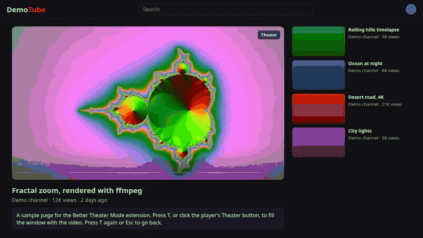
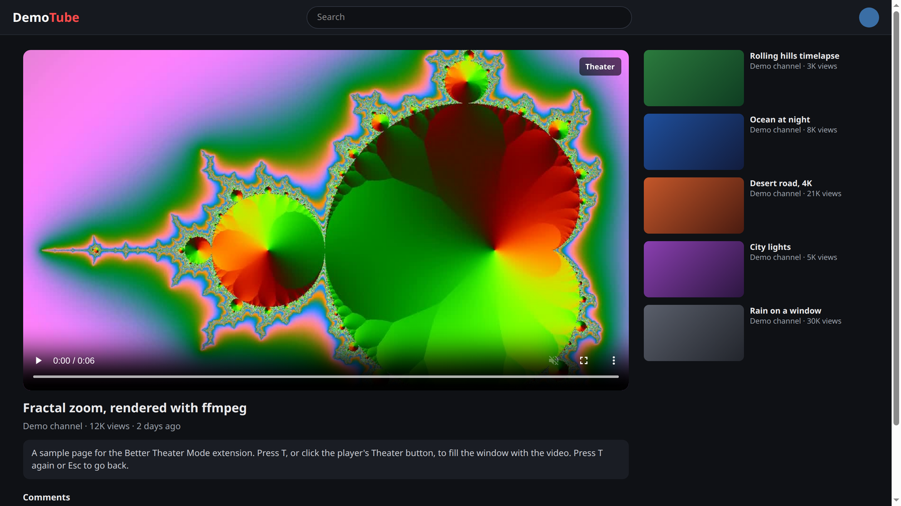
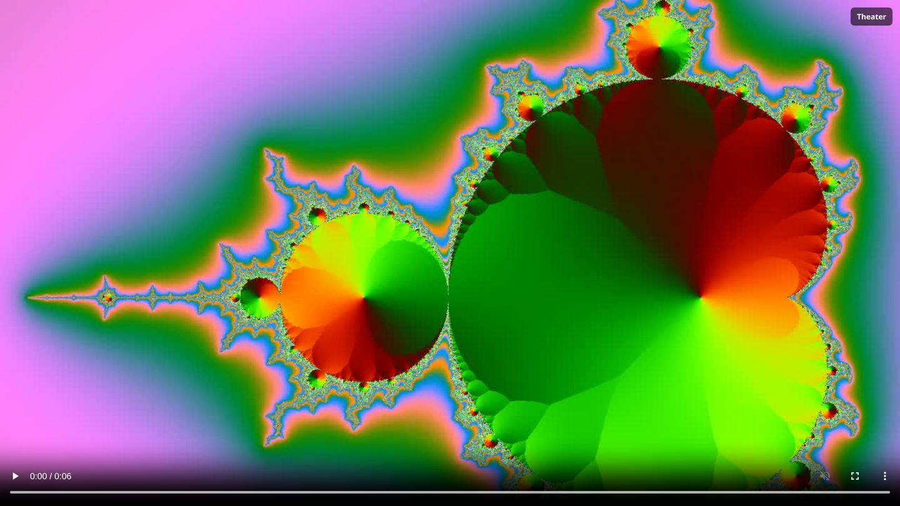
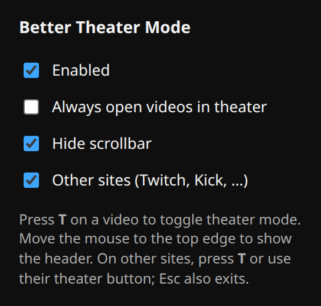

# Better Theater Mode

[](https://github.com/baverrr/Better-Theater-Mode-Chromium-Extension/actions/workflows/ci.yml)
[](LICENSE)

A Chromium extension (Chrome, Brave, Edge) that makes theater mode fill the whole browser window. The video goes edge to edge on a black background, and the site's header and sidebars get out of the way.

<p align="center">
  
</p>

> [!TIP]
> On any page with a video, press **T** to fill the window. Press **T** again or **Esc** to go back.

**[What it does](#what-it-does)** · **[What you need](#what-you-need)** · **[Install](#install)** · **[How to use it](#how-to-use-it)** · **[Help](#help)**

## What it does

Most sites' theater mode only widens the player a little. Full screen hides your other windows and tabs. This sits in between: the video fills the browser window and nothing else changes.

- **YouTube.** Switch to theater mode and the player fills the window. The header slides away and comes back when you move the mouse to the top edge or scroll down to the comments.
- **Other sites.** Press **T**, or click the site's own theater button (Twitch, Rumble, PeerTube and others), and the player fills the window.
- **Embedded videos.** YouTube, Vimeo, PBS and other players embedded in a page work too, even after you click into the player.
- **Puts the page back.** Leaving theater mode restores the page exactly as it was.
- **Asks for almost nothing.** The only permission is `storage`. It makes no network requests.

<table>
  <tr>
    <td></td>
    <td></td>
    <td></td>
  </tr>
  <tr>
    <td align="center">A video page as the site lays it out</td>
    <td align="center">After pressing T</td>
    <td align="center">The settings popup</td>
  </tr>
</table>

The screenshots and GIF use a made-up local demo page ("DemoTube").

## What you need

- A Chromium-based browser: Chrome, Brave or Edge

## Install

1. Download the project:

   ```bash
   git clone https://github.com/baverrr/Better-Theater-Mode-Chromium-Extension.git
   ```

2. Open `chrome://extensions` (or `brave://extensions`, `edge://extensions`) and turn on **Developer mode**.

3. Click **Load unpacked** and choose the `Better-Theater-Mode-Chromium-Extension` folder.

There is no build step.

## How to use it

1. **YouTube.** Press **T** or the theater button on a video. Move the mouse to the top edge to see the header.
2. **Other sites.** Press **T** on a page with a video, or click the site's theater button.
3. **Go back.** Press **T** again or **Esc**.
4. **Change settings.** Click the extension's icon to open its popup.

<details>
<summary><b>Settings</b></summary>

| Setting | Default | What it does |
| --- | --- | --- |
| Enabled | on | Turns the whole extension on or off |
| Always open videos in theater | off | Clicks YouTube's theater button for you when a video opens |
| Hide scrollbar | on | Hides the page scrollbar while a YouTube video fills the window |
| Other sites (Twitch, Kick, …) | on | The **T** key and theater-button handling on sites other than YouTube |

Settings are saved with `chrome.storage.sync`, so they follow your browser profile. They apply to open tabs right away.
</details>

## Help

**Nothing happens on a page that was already open.** Reload the tab after installing or updating the extension.

**I pulled new changes and nothing changed.** Press the reload button on the extension's card in `chrome://extensions`, then reload open tabs.

**T does nothing on a site.** Check that **Enabled** and **Other sites** are on in the popup.

<details>
<summary><b>For developers</b></summary>

- `manifest.json`: Manifest V3, and which script runs where (YouTube, every other page, embedded frames)
- `theater.js` / `theater.css`: YouTube's own theater mode, restyled. It watches YouTube's `ytd-watch-flexy` element for its `theater` attribute.
- `generic.js`: every other site and embedded players. It finds the biggest visible video, pins its player box to the window with inline styles, and saves the original styles so it can put them back.
- `popup.html` / `popup.js`: the settings popup
- How it fits together: [architecture diagram](docs/diagrams/architecture.svg), drawn with [archgram](https://github.com/byabas/archgram) from [`architecture.archgram.yaml`](docs/diagrams/architecture.archgram.yaml)
- Checks: CI makes sure every script parses, the manifest is valid Manifest V3, and every file it names exists. CodeQL scans the code weekly.
</details>

## License

MIT. See [LICENSE](LICENSE), plus the [Privacy](PRIVACY.md) page. The extension collects nothing.
