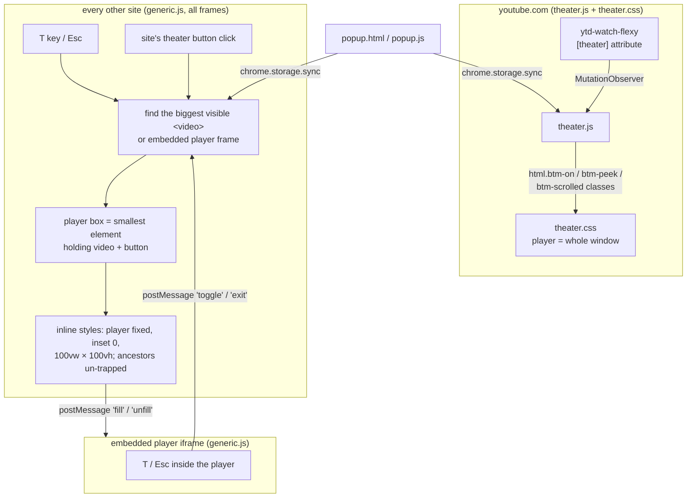

# Better Theater Mode

A Chromium extension (Chrome, Brave, Edge) that makes theater mode fill the
whole browser window, edge to edge on a black background, with the site's
header and sidebars out of the way.

| A video page as the site lays it out | After pressing **T** |
| --- | --- |
|  |  |

*The extension running in Brave on a local demo page (the "DemoTube" site and its video are
made up for the screenshot). Press **T** again or **Esc** and the page goes back exactly as it was.*

## Why

Most sites' theater mode only widens the player a little: the header, the
padding and often a sidebar stay on screen, so the video still doesn't use the
window. Full screen fixes that but takes over the whole display and hides your
other windows and tabs. This extension sits in between: the video fills the
browser window and nothing else changes.

## What it does

- **YouTube:** switch to theater mode (press **T** or the theater button) and
  the player fills the window. The header slides away and comes back when you
  move the mouse to the top edge or scroll down to the comments.
- **Any other site:** press **T** on a page with a video, or click the site's
  own theater button (Twitch, Rumble, PeerTube…), and the player fills the
  window. Press **T** again or **Esc** to go back.
- **Embedded videos:** YouTube, Vimeo, PBS and other players embedded in a
  page work too, including when you've clicked into the player.

The extension's popup has switches to turn it off, always open YouTube videos
in theater mode, hide the scrollbar, and turn off the non-YouTube part.

| Setting | Default | What it does |
| --- | --- | --- |
| Enabled | on | Turns the whole extension on or off |
| Always open videos in theater | off | Clicks YouTube's theater button for you when a video opens |
| Hide scrollbar | on | Hides the page scrollbar while a YouTube video fills the window |
| Other sites (Twitch, Kick, …) | on | The **T** key and theater-button handling on sites other than YouTube |

Settings are stored with `chrome.storage.sync`, so they follow your browser
profile, and they apply to open tabs right away. The only permission the
extension asks for is `storage`; it makes no network requests.

## Install

1. Open `chrome://extensions` (or `brave://extensions`, `edge://extensions`).
2. Turn on **Developer mode**.
3. Click **Load unpacked** and choose this folder.

There is no build step. After pulling changes, press the reload button on the
extension's card and reload open tabs.

## How it works

**YouTube** already has a theater mode, so `theater.js` only watches YouTube's
`ytd-watch-flexy` element for its `theater` attribute and toggles classes on
`<html>`. `theater.css` hangs everything off those classes: the player takes
the whole window, the masthead slides out of the way and peeks back in when the
mouse touches the top edge (`btm-peek`) or the comments are scrolled into view
(`btm-scrolled`).

**Other sites** have no common markup, so `generic.js` works from the video
itself. On **T**, or on a click on anything labelled theater/theatre/cinema, it
picks the biggest visible `<video>` or embedded player frame (skipping 1×1
tracking videos and ones parked off-screen), finds the player box around it,
and sets inline styles that pin it over the page. Inline styles reach players
built as web components (shadow DOM), and each element's original `style`
attribute is saved so leaving restores it exactly. A `MutationObserver` puts
the styles back if the player rewrites its own size. When the site's own
button says "Exit theater mode" afterwards, the extension follows the site's
state instead of toggling on its own.

**Embedded players** can't resize their own frame, so `generic.js` also runs
inside frames: a **T** pressed in an embedded YouTube or Vimeo player is posted
up to the page, which stretches that frame and tells it to fill itself.

## Files

- `manifest.json` — Manifest V3; which script runs where (YouTube, every other
  page, and embedded frames).
- `theater.js` / `theater.css` — YouTube's own theater mode, restyled.
- `generic.js` — every other site and embedded players.
- `popup.html` / `popup.js` — the settings popup.
- `icons/` — extension icons (16, 32, 48 and 128 px).
- `docs/images/` — README screenshots.
- `.github/workflows/ci.yml` — on every push and pull request: every script parses, the manifest
  is valid Manifest V3, and every file it or the popup names exists.
- `.github/workflows/codeql.yml` — CodeQL code scanning of the scripts and workflows, also weekly.
- `PRIVACY.md` — the privacy policy.
- `LICENSE` — MIT License.

## Privacy

The extension collects nothing and makes no network requests; its settings are kept with
`chrome.storage.sync`. See [PRIVACY.md](PRIVACY.md) for the full policy.

## License

[MIT](LICENSE), copyright 2026 baverrr.
